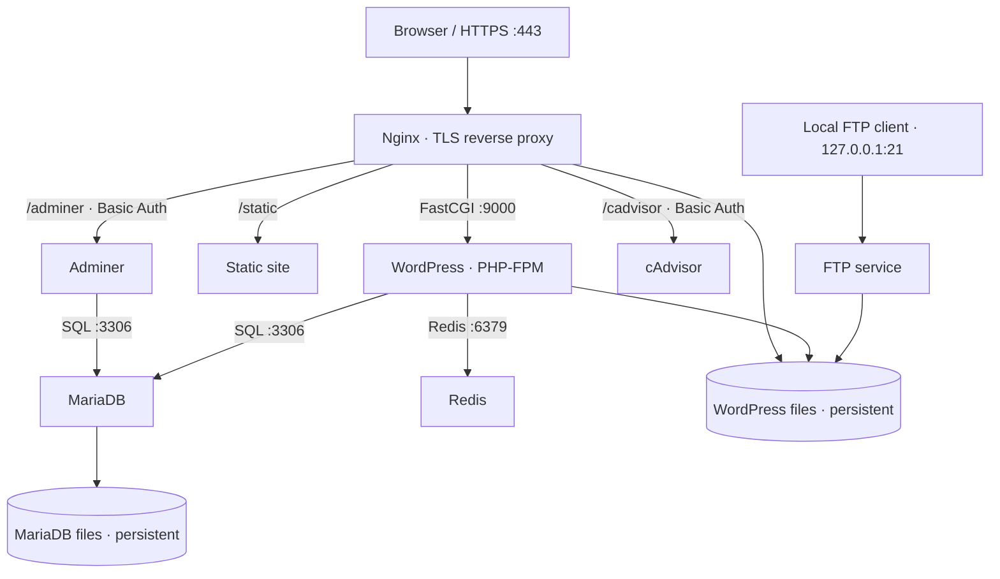

# Inception — Dockerized WordPress Infrastructure

*Created as part of the 42 curriculum by **obendaou**.*

Inception is a containerized web infrastructure built using **custom Debian-based Docker images** and **Docker Compose**. It runs WordPress with PHP-FPM behind an HTTPS Nginx entry point, stores content in MariaDB, and adds Redis caching, file transfer, database administration, monitoring, and a static site.

> **Scope:** This is a local development / educational deployment, not a hardened public-production hosting stack. The HTTPS certificate is self-signed.

## Architecture



All eight containers join the Compose bridge network named `inception`. Internal services are resolved by Docker DNS using Compose service names (for example, `mariadb` and `redis`). Only ports explicitly published with `ports:` are exposed to the host.

### Services

| Service | Role | Network exposure |
| --- | --- | --- |
| **nginx** | TLS entry point; WordPress, static content, and admin-tool routes | Host TCP **443** |
| **wordpress** | PHP-FPM application and WP-CLI bootstrap | Internal FastCGI **9000** |
| **mariadb** | Persistent WordPress relational database | Internal TCP **3306** |
| **redis** | WordPress object-cache backend | Internal TCP **6379** |
| **ftp** | Access to shared WordPress files | Host loopback TCP **21**, passive **21000–21010** |
| **adminer** | Browser-based database administration via Nginx | Nginx route **/adminer**, Basic Auth |
| **cadvisor** | Container metrics via Nginx | Nginx route **/cadvisor**, Basic Auth |
| **static_site** | Serves static web content | Nginx route **/static** |

The `depends_on` settings control container startup order, **not database readiness**. WordPress uses a bounded connection retry before installing its schema.

## Design decisions

**Containers vs VMs.** Containers share the Linux kernel of their Docker host, while VMs run guest operating systems. On macOS this project runs Linux containers inside a Docker-compatible Linux VM (for example, Colima).

**Network isolation.** MariaDB, Redis, PHP-FPM, and the bonus web applications have no direct host port mappings. Nginx is the HTTPS gateway. FTP is explicitly bound to `127.0.0.1`, so it is not reachable through other host network interfaces by default. Its vsftpd configuration also requires TLS for authenticated sessions and data transfers.

**Persistence.** Compose declares named volumes `db_data` and `wp_data`, but each uses the `local` driver with a **bind mount** pointing into `DATA_DIR`. Database and WordPress data therefore persist in host directories at `${DATA_DIR}/mariadb` and `${DATA_DIR}/wordpress`. Removing containers does not delete those host directories.

**Credentials.** Compose `secrets:` entries mount local secret files under `/run/secrets/` inside the relevant containers. In this non-Swarm Compose setup, these are file-backed mounts, **not automatically encrypted secret storage**. Keep the source files out of Git, limit local permissions, and use unique passwords. Only non-sensitive settings belong in `srcs/.env`.

**Recovery.** The MariaDB entrypoint supports application-database initialization following an interrupted bootstrap and writes `.inception-init-complete` after successful setup. WordPress checks the existing files, configuration, installation, author account, and Redis plugin before attempting each setup step.

## Requirements

- Docker Engine with the Compose CLI (this repository's Makefile invokes the **`docker-compose`** command).
- `make`, `bash`, and write access to a host directory for persistent data.
- Host TCP port **443** available; loopback port **21** and ports **21000–21010** for FTP.
- A local hosts-file entry mapping `obendaou.42.fr` to `127.0.0.1`.

> **macOS:** A Linux Docker environment such as Colima is needed. Permissions and low-numbered ports may behave differently than on Linux. This project has been exercised with Colima and `docker-compose`; an independent native-Linux portability test is still recommended.

## Setup

### 1. Clone and configure

```bash
git clone git@github.com:obendaou/inception.git
cd inception
cp srcs/.env.example srcs/.env
```

Edit `srcs/.env` to match your machine. The committed example contains:

```dotenv
DOMAIN_NAME=obendaou.42.fr
DATA_DIR=/home/obendaou/data
SQL_DATABASE=wordpress
SQL_USER=wpuser
SQL_HOST=mariadb
FTP_USER=ftpuser
```

Set `DATA_DIR` to an **absolute path** that Docker can access (for example, `/home/<linux-user>/data` on Linux or `/Users/<mac-user>/inception-data` on macOS).

Ensure the environment's SQL host matches the Compose service name `mariadb`, and that its database/user names are valid MariaDB identifiers.

### 2. Create local secret files

Create the ignored `secrets` directory and populate each required file with a **different strong secret**:

```bash
mkdir -p secrets
chmod 700 secrets
touch secrets/db_password.txt secrets/db_root_password.txt \
      secrets/wp_admin_password.txt secrets/wp_author_password.txt \
      secrets/ftp_password.txt
chmod 600 secrets/*.txt
```

Fill the files using your preferred local editor or a password manager. **Do not commit them or paste real values into issues or logs.**

Nginx also requires `secrets/nginx.htpasswd`, an Apache-compatible Basic Auth password file, for Adminer and cAdvisor. For example, if `htpasswd` is installed:

```bash
htpasswd -cB secrets/nginx.htpasswd admin
chmod 600 secrets/nginx.htpasswd
```

This command prompts for an admin-tools password. Avoid re-running `htpasswd -c` on an existing file because it replaces its contents.

### 3. Configure local DNS and start

Add the following entry to your machine's hosts file (commonly `/etc/hosts`):

```text
127.0.0.1 obendaou.42.fr
```

Start the stack:

```bash
make
make ps
make logs
```

The Makefile creates the `DATA_DIR` subdirectories before running `docker-compose up -d --build`.

### 4. Open the services

| URL | Description |
| --- | --- |
| `https://obendaou.42.fr/` | WordPress |
| `https://obendaou.42.fr/static` | Static site |
| `https://obendaou.42.fr/adminer` | Adminer (Basic Auth required) |
| `https://obendaou.42.fr/cadvisor` | cAdvisor (Basic Auth required) |

Your browser will warn about the **self-signed TLS certificate**. This certificate is intended for local use; do not deploy it as a publicly trusted production certificate.

## Operation

```bash
make ps        # List project containers
make logs      # View recent logs
make stop      # Stop containers
make start     # Restart stopped containers
make restart   # Restart services
make down      # Remove Compose containers/network; keep host data
make clean     # Remove project containers and locally built images
```

`make fclean` additionally requests Compose volume removal; treat it as a destructive cleanup operation and **back up important data first**. Because volumes use host bind mounts, their host directories are not automatically removed by that target.

## Health and recovery checks

Check a site response (the self-signed certificate requires `-k` for this local test):

```bash
curl -k -I https://obendaou.42.fr/
docker-compose -f srcs/docker-compose.yml --env-file srcs/.env logs --tail=80 wordpress mariadb
```

Check that WordPress installation persists:

```bash
docker exec wordpress sh -c 'cd /var/www/wordpress && wp core is-installed --allow-root'
```

Check Redis caching:

```bash
docker exec wordpress sh -c 'cd /var/www/wordpress && wp redis status --allow-root'
```

Confirm that the MariaDB app initialization completed:

```bash
docker exec mariadb test -f /var/lib/mysql/.inception-init-complete
```

**Common issues:**

- **HTTP 502:** Inspect WordPress and MariaDB logs; verify MariaDB is ready and the SQL credentials agree across the containers.
- **WordPress restart loop:** Check for partially downloaded core files or an incomplete `wp-config.php`; the entrypoint is intended to resume rather than reinstall.
- **HTTP 301 on a test port:** WordPress redirects to its configured canonical domain, which normally omits a temporary test port such as `8443`.
- **HTTP 401 on /adminer or /cadvisor:** Supply valid credentials from `secrets/nginx.htpasswd`.
- **Data seems missing:** Confirm `DATA_DIR` and the effective Compose volume mounts before making changes. Do **not** run volume-pruning commands while debugging.

## Security notes and limitations

- Nginx terminates TLS 1.2/1.3; the certificate is self-signed.
- Adminer and cAdvisor are accessible through password-protected Nginx routes, but access to them should remain restricted to trusted environments.
- FTP is limited to loopback at the host; the vsftpd configuration **requires TLS for local logins and data transfers (FTPS)** with a self-signed certificate. Verify certificate trust and client TLS mode; do not silently fall back to unencrypted FTP.
- Local Compose secrets and host bind mounts must be protected by host filesystem permissions and appropriate backups.
- cAdvisor reads host/container runtime information through mounted paths; this provides substantial visibility into the Docker host. Review its privileges before running on shared machines.
- Initialization markers protect against repeated setup but are not database integrity checks or backup mechanisms.

## References

- [Docker documentation](https://docs.docker.com/)
- [Docker Compose secrets](https://docs.docker.com/compose/how-tos/use-secrets/)
- [Docker volumes and bind mounts](https://docs.docker.com/storage/)
- [MariaDB Knowledge Base](https://mariadb.com/kb/en/)
- [WordPress WP-CLI](https://wp-cli.org/)
- [NGINX documentation](https://nginx.org/en/docs/)

### AI usage disclosure

Large language models were used for architectural explanation, troubleshooting, and code-review assistance, including Docker PID 1 behavior, FTP passive ports, MariaDB/WordPress initialization recovery, and documentation drafting. Implementation, tests, and repository changes remain reviewable in the Git history.
